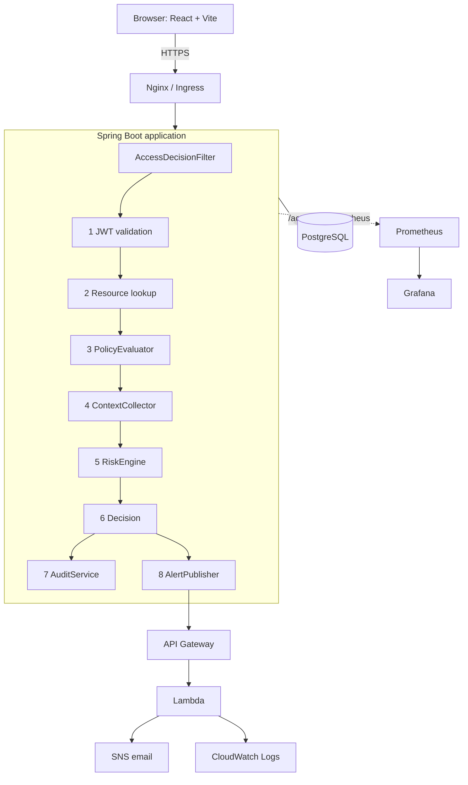

# Architecture

## Packages (`com.trustflow`)

| Package | Responsibility |
|---------|----------------|
| auth | JWT issue/validate, security config, login, simulated TOTP MFA |
| user | users, roles, devices, login attempts, admin user API |
| resource | protected resources and sensitivity |
| policy | policies, evaluator (RBAC + validity window), temporary access requests |
| risk | rule-based RiskEngine (pure Java), configuration in `risk_config` |
| context | device status, time, failed login count |
| gateway | the decision pipeline and `POST /api/gateway/access` |
| audit | append-only audit events and search |
| alert | high-risk event and publisher (HTTP to API Gateway) |
| common | metrics, error handling, client IP |

The risk engine has no framework dependency, which is why it can be unit-tested and BDD-tested without a database.

## Deployment on AWS

Custom VPC 10.0.0.0/16 with a public subnet (Nginx, k3s app node, Jenkins, monitoring) and a private subnet (reserved for the
database node; optional because it needs a NAT gateway). Security groups: 80/443 open, 22 and tool ports only from the
administrator IP, 5432 only from the application group. EC2 uses an IAM instance role (no keys on servers), S3 holds audit
exports and Terraform state, CloudWatch collects Lambda and system logs.

## Data model

See `backend/src/main/resources/db/migration` (V1 schema, V2 seed, V3 extensions).
